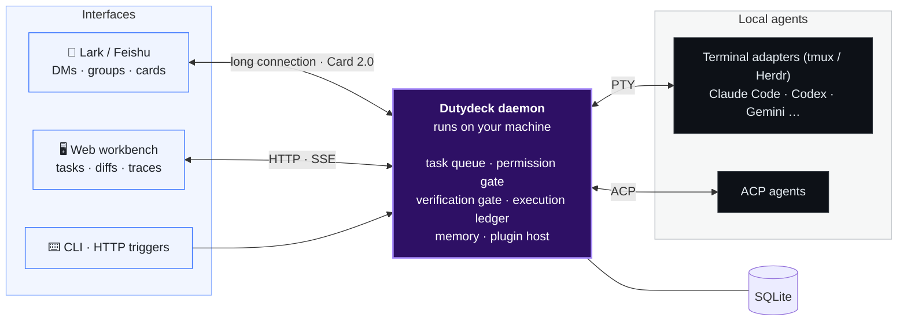

<div align="center">


<p>
  <a href="#quick-start"></a>
  
  
  
  
</p>

<p>
  <b>A local-first workbench for AI coding agents.</b><br>
  Send one message in Lark and the agent works on your own machine;<br>
  approve file writes and commands from your phone, get the result back as a card, and follow every step in the Web workbench.
</p>

<p>
  <a href="#quick-start"><b>Quick Start</b></a> ·
  <a href="#features"><b>Features</b></a> ·
  <a href="#web"><b>Web Workbench</b></a> ·
  <a href="#docs"><b>Docs</b></a> ·
  <a href="./README.md"><b>简体中文</b></a>
</p>

</div>

<br>

<p align="center">
  
</p>

## 💡 Why Dutydeck <a id="why"></a>

Coding agents keep getting better, but they live in a terminal: you have to sit at your desk and a dropped SSH session kills the run; let them run unattended and you worry about what they change or execute; when one says "tests pass", you can't tell whether it actually ran them.

**Dutydeck is a daemon on your dev machine** that connects Claude Code, Codex and other agents to Lark and the Web:

| | Terminal CLI alone | With Dutydeck |
|---|---|---|
| 📱 **Dispatch** | Tied to your desk; disconnects kill the run | One message in Lark; runs in the background; results come back as cards |
| 🛡️ **Risky actions** | Either YOLO mode or constant prompts | Tap "Allow once" or "Reject" on the card, from your phone |
| ✅ **Quality** | The agent claims tests pass; maybe they never ran | The server runs your verification command and sends failures back for repair |
| 🌳 **Workspace** | Edits your current branch and uncommitted work | Optional Git worktree that leaves your main checkout alone |
| 🧠 **Context** | Every new session starts from scratch | Long-term memory, selective group participation, scheduled tasks |

## ✨ Features <a id="features"></a>

<table>
<tr>
<td width="33%" valign="top">

### 📱 Dispatch from Lark
DM the bot or @ it in a group. Progress cards update live and long output is attached as Markdown. Forgot the @? Add it afterwards.

<sub>→ <a href="docs/en/lark.md">Lark bridge</a></sub>
</td>
<td width="33%" valign="top">

### 🛡️ Approve on your phone
Before writing files or running commands, an approval card asks: "Allow once / Allow this command for the session / Reject". Four permission modes.

<sub>→ <a href="docs/en/agents.md">Agents & permissions</a></sub>
</td>
<td width="33%" valign="top">

### ✅ Verification gate
Set a verification command (e.g. `pnpm test`) and the server runs it after a Lark task changes code, recording exit code and a code fingerprint; failures go back for repair.

<sub>→ <a href="docs/en/web-console.md">Web workbench</a></sub>
</td>
</tr>
<tr>
<td valign="top">

### 🔍 Review diffs on mobile
Result cards link to "N files changed +A −D · View changes": the diff of that turn, with line comments the agent can pick up.

<sub>→ <a href="docs/en/web-console.md">Web workbench</a></sub>
</td>
<td valign="top">

### ⏰ Schedules in plain words
Say "every day at 18:00, summarize this group's progress". The agent posts a card saying what, when and where; it starts only after you enable it.

<sub>→ <a href="docs/en/features.md">Features in depth</a></sub>
</td>
<td valign="top">

### 🔁 Open PRs and follow up
`/pr` lists the files for you to confirm, pushes a new `dutydeck/` branch, opens the PR, then follows up on CI failures and review comments (GitHub plugin required).

<sub>→ <a href="docs/en/features.md">Features in depth</a></sub>
</td>
</tr>
<tr>
<td valign="top">

### 🧠 Long-term memory
`/remember` saves a fact; once enabled, the background job extracts environment facts and preferences. Private chats stay separate; groups can share or isolate memory.

<sub>→ <a href="docs/en/features.md">Features in depth</a></sub>
</td>
<td valign="top">

### ♻️ Survives restarts
Restarts and deploys keep recoverable terminal tasks running. A turn with an unknown outcome is never silently re-sent; you get a card to decide.

<sub>→ <a href="docs/en/lark.md">Lark bridge</a></sub>
</td>
<td valign="top">

### 🔌 Pluggable
Commands, agents, skills, external triggers, hooks, CI providers and group scenario packs are all plugins. The core has no platform-specific code.

<sub>→ <a href="docs/en/plugins.md">Plugins</a></sub>
</td>
</tr>
</table>

## 🖥️ Web Workbench <a id="web"></a>

Away from Lark, open `http://127.0.0.1:4310`: task board, conversation and tool calls, per-turn diffs, terminal playback, usage and cost, and schedules, in light and dark themes.

<p align="center">
  <picture>
    <source media="(prefers-color-scheme: dark)" srcset="docs/assets/web-task-dark.png">
    
  </picture>
</p>

<table>
<tr>
<td width="50%"></td>
<td width="50%"></td>
</tr>
<tr>
<td align="center"><sub>Workbench: tasks that need you come first</sub></td>
<td align="center"><sub>Per-turn changes, file by file</sub></td>
</tr>
</table>

## 🚀 Quick Start <a id="quick-start"></a>

You need Node.js ≥ 22.12, `tmux`, and an installed, signed-in agent CLI (Claude Code, Codex, …).

```bash
# 1. Install
pnpm add -g @byted/dutydeck --registry=http://bnpm.byted.org

# 2. Setup wizard: detects local agents, picks the default directory, optionally binds a Lark bot
dutydeck setup

# 3. Start the daemon, then run a health check (it prints copy-paste fixes)
dutydeck start && dutydeck doctor
```

Open **http://127.0.0.1:4310** (no login for local requests). Click 「绑定飞书 Bot」 (Bind Lark bot) → 「一键创建飞书机器人」 (one-click create), finish the authorization, and start dispatching from Lark.

<sub>Scripted installs, development from source and more options: <a href="docs/en/getting-started.md">Getting started</a>.</sub>

## 🤖 Supported Agents <a id="agents"></a>

**30 built-in terminal adapters**, plus any [ACP](https://agentclientprotocol.com) agent; register custom agents with `DUTYDECK_AGENTS_JSON`.

| Agent | Connection | Per-action Lark approval |
|---|---|:---:|
| **Claude Code** (including gateway / custom-settings variants) | Terminal · ACP | ✅ |
| **Codex** | Terminal (`codex`) · ACP (`codex-acp`) | ACP ✅ |
| **Seed**, **Relay** | Terminal | ✅ |
| **Gemini CLI**, **Copilot CLI**, **Cursor**, **OpenCode**, **Kimi**, **Grok**, **Kiro**, **TraeX**, **CodeM** and more | Terminal | full trust only |
| Any **ACP agent** | ACP | ✅ |

<sub>Terminal agents run in <code>tmux</code> by default (Herdr is also supported). Agents without per-action approval can only use <code>full-trust</code>; see <a href="docs/en/agents.md">Agents & permissions</a>.</sub>

## 🏗️ How It Works <a id="how-it-works"></a>



- **Local-first**: agents, code and credentials stay on your machine. The daemon listens on `127.0.0.1` by default; remote access requires login.
- **No guessing**: every turn is recorded in an execution ledger; timeouts, disconnects and restarts are never treated as "not executed" and re-sent automatically.
- **Leak guard**: optionally blocks reads of `~/.ssh`, `.env`, agent session logs and the like; common secrets in cards and group messages are redacted.

## 📚 Documentation <a id="docs"></a>

| Doc | What's inside |
|---|---|
| [Getting started](docs/en/getting-started.md) | Install, setup wizard, non-interactive setup, development from source |
| [Features in depth](docs/en/features.md) | Details, defaults and limits of the core capabilities |
| [Lark bridge](docs/en/lark.md) | Task lifecycle, commands, `/plan`, `/pr`, group participation, bot setup |
| [Web workbench](docs/en/web-console.md) | Task details, usage and cost, schedules, configuration sources and memory |
| [Agents & permissions](docs/en/agents.md) | Custom agents, terminal task recovery, permission modes, environment variables |
| [Plugins](docs/en/plugins.md) | Plugin layout, triggers, business tools, hooks, CI providers, scenario packs |
| [CLI & operations](docs/en/cli.md) | Daemon, deploy and rollback, backup and restore, `settings`, remote access, checks |
| [Upgrade notes](docs/en/upgrading.md) | Behavior changes to watch when upgrading |
| [Known limits & FAQ](docs/en/troubleshooting.md) | Known limits and troubleshooting |

## 🛠️ Development

```bash
git clone https://github.com/ITcathyh/dutydeck.git
cd dutydeck
pnpm install
cp .env.example .env
pnpm dev        # Web http://127.0.0.1:4311, API http://127.0.0.1:4310
```

A pnpm monorepo: `apps/server` (daemon and CLI), `apps/web` (Web workbench), `packages/*` (runtime, ACP/terminal drivers, storage, plugin SDK and more). Conventions and verification requirements are in [AGENTS.md](AGENTS.md); E2E tests in [tests/e2e/README.md](tests/e2e/README.md).

## 📄 License

Dutydeck core code is licensed under open-source terms. See [Third-Party Notices](THIRD_PARTY_NOTICES.md) for details.
