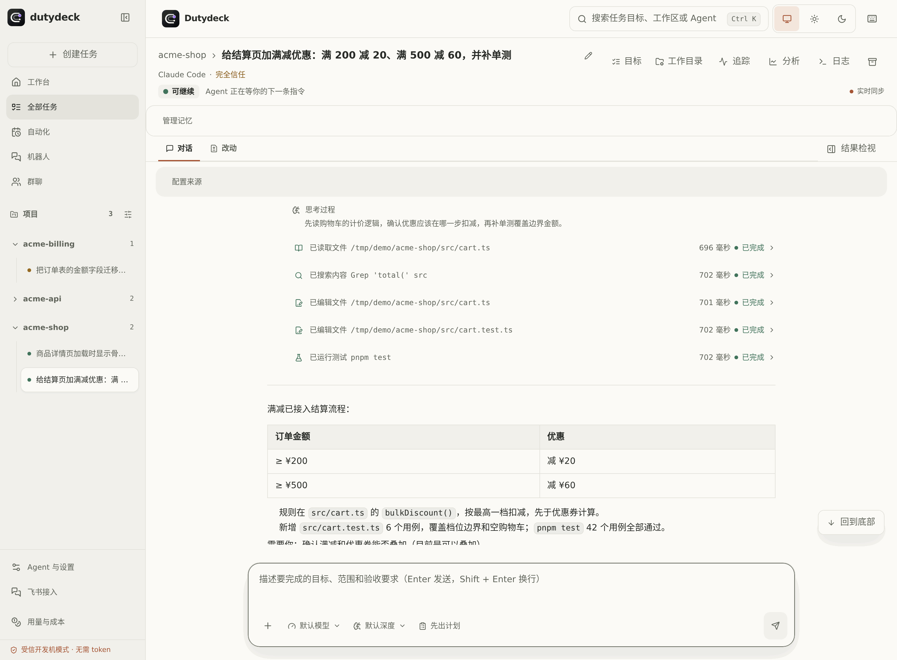
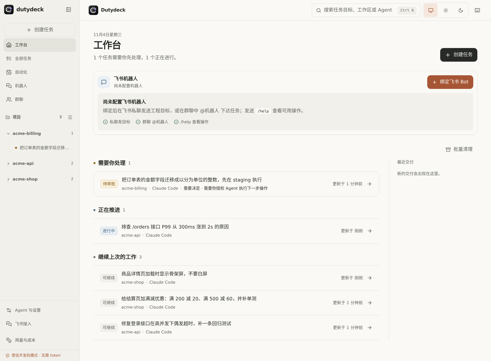
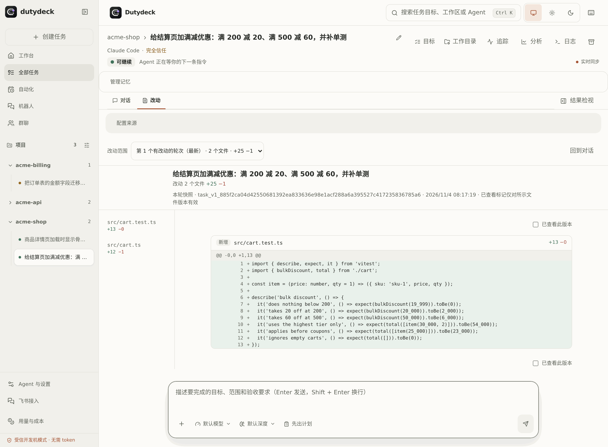
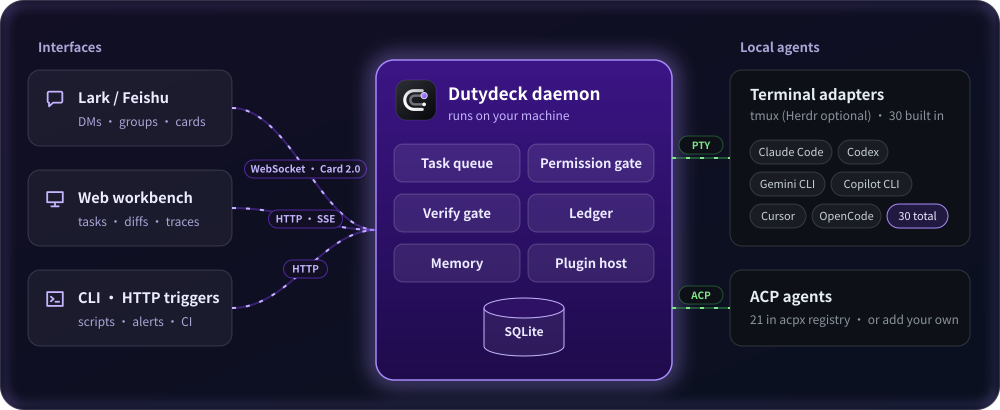

<a id="readme-top"></a>

<div align="center">



<h3>Dispatch in Lark, agents work on your machine</h3>

![Node.js ≥ 22.12][node-shield] ![pnpm ≥ 11][pnpm-shield] ![tmux][tmux-shield] ![Lark Card 2.0][lark-shield] ![ACP compatible][acp-shield]

<a href="#quick-start"><b>Quick&nbsp;Start</b></a> • <a href="#features"><b>Features</b></a> • <a href="#web"><b>Web&nbsp;Workbench</b></a> • <a href="#agents"><b>Supported&nbsp;Agents</b></a> • <a href="#docs"><b>Docs</b></a> • <a href="https://github.com/ITcathyh/dutydeck/issues"><b>Issues</b></a>

<sub><a href="README.md">简体中文</a> · English</sub>

</div>


<p align="center"><sub><i>Illustration: card fields follow the real Lark cards (labels translated from Chinese) and some buttons only appear under conditions; the task is a made-up example</i></sub></p>

<a id="install"></a>

```sh
git clone https://github.com/ITcathyh/dutydeck.git && cd dutydeck
# Install dependencies and build
pnpm install && pnpm build
# Pack an npm tarball, then install the global dutydeck command
pnpm --filter @byted/dutydeck pack --pack-destination "$PWD"
npm install -g ./byted-dutydeck-*.tgz
# Wizard: detects local agents, can bind a Lark bot
dutydeck setup
# Start the daemon and run a health check
dutydeck start && dutydeck doctor
```

Once `doctor` passes, open `http://127.0.0.1:4310`. Prerequisites and other install options: [Quick Start](#quick-start).

## 💡 Why Dutydeck <a id="why"></a>

Most coding agents only run in a terminal: you have to sit at your desk and a dropped SSH session kills the run; let them run unattended and you worry about what they change or execute; when one says "tests pass", you can't tell whether it ran them. **Dutydeck is a daemon on your dev machine** that connects Claude Code, Codex and other agents to Lark and a web workbench.

| | Terminal CLI alone | With Dutydeck |
|---|---|---|
| **Dispatch** | <sub>Tied to your desk; SSH drops kill it</sub> | ✅ One Lark message, runs in background |
| **Risky actions** | <sub>YOLO mode, or constant prompts</sub> | ✅ Approve each action on your phone |
| **Quality** | <sub>Claims tests pass; maybe never ran</sub> | ✅ Server runs the verify command |
| **Workspace** | <sub>Edits your current branch</sub> | ✅ Optional separate worktree |
| **Restarts** | <sub>Process stops, work is gone</sub> | ✅ Recoverable tasks are kept |

<p align="center">
  
</p>

<p align="center"><sub>Dispatch → Approve → Server-side verification (up to 2 repair rounds on failure) → Result card<br>The "Allow for session" and "Allow in workspace" buttons depend on who started the turn, the command type and permissions</sub></p>

| [**30**](packages/cli-adapters/src/factory.ts) | [**21**](packages/acp-client/src/index.ts) | [**2 rounds**](docs/en/web-console.md) | [**14 days**](docs/en/web-console.md) |
|:---:|:---:|:---:|:---:|
| <sub>built-in terminal adapters</sub> | <sub>ACP agents in the acpx registry</sub> | <sub>max repair rounds after a failed check</sub> | <sub>lifetime of a mobile diff link</sub> |

## ✨ Features <a id="features"></a>

<table>
<tr>
<td width="50%" valign="top">
📱 <b>Dispatch from Lark</b><br>
DM the bot or @ it in a group; progress cards update live.<br>
<sub>→ <a href="docs/en/lark.md">Lark bridge</a></sub>
</td>
<td width="50%" valign="top">
🛡️ <b>Approve on your phone</b><br>
A card pops up before file writes and commands; tap to allow.<br>
<sub>→ <a href="docs/en/agents.md">Agents & permissions</a></sub>
</td>
</tr>
<tr>
<td valign="top">
✅ <b>Verification gate</b><br>
The server verifies Lark tasks; failures get up to 2 repair rounds.<br>
<sub>→ <a href="docs/en/web-console.md">Web workbench</a></sub>
</td>
<td valign="top">
🔍 <b>Review diffs on mobile</b><br>
The result card opens this turn's diff, with line comments.<br>
<sub>→ <a href="docs/en/web-console.md">Web workbench</a></sub>
</td>
</tr>
<tr>
<td valign="top">
⏰ <b>Schedules in plain words</b><br>
Say "every day at 18:00, summarize this group"; it starts once you enable it.<br>
<sub>→ <a href="docs/en/features.md#key-highlights">Key capabilities</a></sub>
</td>
<td valign="top">
🔁 <b>Open PRs and follow up</b><br>
<code>/pr</code> opens a PR once you confirm the files, then follows up on CI and review comments (GitHub plugin required).<br>
<sub>→ <a href="docs/en/lark.md">Lark bridge</a></sub>
</td>
</tr>
<tr>
<td valign="top">
🧠 <b>Long-term memory</b><br>
<code>/remember</code> saves a fact, or let a background job extract them.<br>
<sub>→ <a href="docs/en/features.md#key-highlights">Key capabilities</a></sub>
</td>
<td valign="top">
♻️ <b>Survives restarts</b><br>
Turns with an unknown outcome are never re-sent; a card asks you.<br>
<sub>→ <a href="docs/en/lark.md">Lark bridge</a></sub>
</td>
</tr>
<tr>
<td colspan="2" valign="top">
🔌 <b>Pluggable</b><br>
CI, code hosting and other external integrations ship as plugins.<br>
<sub>→ <a href="docs/en/plugins.md">Plugins</a></sub>
</td>
</tr>
</table>

<div align="right"><sub><a href="#readme-top">↑ Back to top</a></sub></div>

## 🖥️ Web Workbench <a id="web"></a>

Away from Lark, open `http://127.0.0.1:4310`: task board, conversation and tool calls, per-turn diffs, usage and cost, and schedules; terminal-mode agents also get terminal playback. Light and dark themes. The Web UI is currently Chinese-only.

<p align="center">
  <picture>
    <source media="(prefers-color-scheme: dark)" srcset="docs/assets/web-task-dark.png">
    
  </picture>
</p>

<table>
<tr>
<td width="50%"></td>
<td width="50%"></td>
</tr>
<tr>
<td align="center"><sub>Workbench: tasks that need you come first</sub></td>
<td align="center"><sub>Per-turn changes, file by file</sub></td>
</tr>
</table>

## 🚀 Quick Start <a id="quick-start"></a>

> [!NOTE]
> You need Node.js ≥ 22.12, pnpm ≥ 11, `tmux`, and an installed, signed-in agent CLI (Claude Code, Codex, …).

After running [the commands at the top](#install):

1. Open `http://127.0.0.1:4310` (no login for local requests).
2. Click **绑定飞书 Bot** (Bind Lark bot) → **一键创建飞书机器人** (one-click create) and finish the authorization.
3. DM the bot in Lark, or @ it in a group, to dispatch work.

<details>
<summary><b>Other install options</b></summary>

- **ByteDance intranet**: `pnpm add -g @byted/dutydeck --registry=http://bnpm.byted.org`, then `dutydeck setup` and `dutydeck start` as above.
- **Scripts / CI, no prompts**: `dutydeck setup --cwd /path/to/project --port 4310 --skip-lark --yes`; Lark binding flags are in [Getting started](docs/en/getting-started.md).
- **Hot-reload development from source**: see [Development](#dev) below.

</details>

<details>
<summary><b>Let your agent install it</b></summary>

Send this to your coding agent:

```text
Install and start Dutydeck for me:
https://github.com/ITcathyh/dutydeck
1. Check that Node.js ≥ 22.12, pnpm ≥ 11 and tmux are installed;
   tell me what is missing.
2. Clone, build, pack and globally install the dutydeck command
   using the commands at the top of the README.
3. Run dutydeck setup --skip-lark --yes to configure this machine
   only, then run dutydeck start.
4. Run dutydeck doctor and list any failed checks with the fix
   commands it prints.
```

</details>

## 🤖 Supported Agents <a id="agents"></a>

Dutydeck ships **30 built-in terminal adapters**, and ACP agents (21 in the acpx registry) show up automatically when no terminal adapter covers them. When an agent supports both, the terminal adapter wins, so Gemini or Cursor, for example, can only use `full-trust` in Lark; for per-action approval, set `protocol: "acp"` for it in `DUTYDECK_AGENTS_JSON`, which is also where you register custom agents.

| Agent | Connection | Per-action Lark approval |
|---|---|:---:|
| **Claude Code** (including gateway / custom-settings variants) | Terminal · ACP | ✅ |
| **Codex** | Terminal (`codex`) · ACP (`codex-acp`) | ACP ✅ |
| **ACP agents** (Qwen Code, Factory Droid, iFlow and more, auto-detected) | ACP | ✅ |

> [!WARNING]
> `full-trust` skips per-action approval: the agent writes files and runs commands without asking. Use it only in isolated environments or pipelines you trust.

Approval support and permission modes per agent: [Agents & permissions](docs/en/agents.md).

<div align="right"><sub><a href="#readme-top">↑ Back to top</a></sub></div>

## 🏗️ How It Works <a id="how-it-works"></a>

<p align="center">
  
</p>

- **Entry points**: Lark (WebSocket + Card 2.0), the Web workbench, CLI / HTTP triggers.
- **Daemon**: runs on your machine; owns the task queue, permission gate, verification gate, memory and plugins.
- **Execution ledger**: every turn is recorded in SQLite as not submitted, running or outcome unknown.
- **Drivers**: terminal mode drives CLIs over a PTY; ACP agents speak ACP.
- **Session backend**: terminal mode uses `tmux` by default; existing Herdr setups keep working.

**Local-first**: agents, code and credentials stay on your machine; the daemon listens on `127.0.0.1` by default and remote access requires login.<br>
**No guessing**: timeouts, disconnects and restarts are never treated as "not executed" and re-sent automatically.<br>
**Leak guard**: optionally blocks reads of `~/.ssh`, `.env`, agent session logs and the like; common secrets in cards and group messages are redacted.

## 📚 Documentation <a id="docs"></a>

| Doc | What's inside |
|---|---|
| 🚀 [Getting started](docs/en/getting-started.md) | Install, setup wizard, non-interactive setup, development from source |
| ✨ [Features in depth](docs/en/features.md) | Details, defaults and limits of the core capabilities |
| 📱 [Lark bridge](docs/en/lark.md) | Task lifecycle, commands, `/plan`, `/pr`, group participation, bot setup |
| 🖥️ [Web workbench](docs/en/web-console.md) | Task details, verification and repair, mobile diffs, usage and cost, schedules |
| 🤖 [Agents & permissions](docs/en/agents.md) | Custom agents, terminal task recovery, permission modes, environment variables |
| 🔌 [Plugins](docs/en/plugins.md) | Plugin layout, triggers, business tools, hooks, CI providers, scenario packs |
| ⌨️ [CLI & operations](docs/en/cli.md) | Daemon, deploy and rollback, backup and restore, `settings`, remote access, checks |
| ⬆️ [Upgrade notes](docs/en/upgrading.md) | Behavior changes to watch when upgrading |
| ❓ [Known limits & FAQ](docs/en/troubleshooting.md) | Known limits and troubleshooting |

<sub>For AI coding agents: conventions and verification requirements are in <a href="AGENTS.md">AGENTS.md</a>.</sub>

<div align="right"><sub><a href="#readme-top">↑ Back to top</a></sub></div>

## 🛠️ Development <a id="dev"></a>

```bash
git clone https://github.com/ITcathyh/dutydeck.git
cd dutydeck
pnpm install
cp .env.example .env
pnpm dev        # Web http://127.0.0.1:4311, API http://127.0.0.1:4310
```

A pnpm monorepo: `apps/server` (daemon and CLI), `apps/web` (Web workbench), `packages/*` (runtime, ACP/terminal drivers, storage, plugin SDK and more); E2E tests in [tests/e2e/README.md](tests/e2e/README.md).

## 📄 License

No open-source license has been declared for this repository yet; until a LICENSE file is added, all rights are reserved. Third-party code and assets, with their licenses, are listed in [THIRD_PARTY_NOTICES.md](THIRD_PARTY_NOTICES.md).

<div align="center">
<br>

<p><sub>Dispatch in Lark. Work on your machine.</sub></p>
<a href="#readme-top">↑ Back to top</a>
</div>

[node-shield]: https://img.shields.io/badge/Node.js-%E2%89%A5_22.12-339933?style=flat-square&logo=nodedotjs&logoColor=white
[pnpm-shield]: https://img.shields.io/badge/pnpm-%E2%89%A5_11-F69220?style=flat-square&logo=pnpm&logoColor=white
[tmux-shield]: https://img.shields.io/badge/tmux-required-1BB91F?style=flat-square&logo=tmux&logoColor=white
[lark-shield]: https://img.shields.io/badge/Lark-Card_2.0-3370FF?style=flat-square
[acp-shield]: https://img.shields.io/badge/ACP-compatible-0EA5E9?style=flat-square
