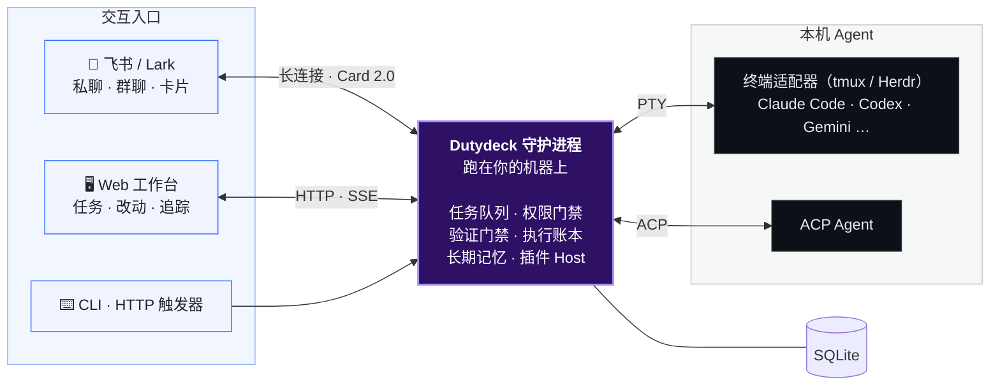

<div align="center">


<p>
  <a href="#quick-start"></a>
  
  
  
  
</p>

<p>
  <b>本地优先的 AI 编码 Agent 工作台。</b><br>
  在飞书发一句话派活，Agent 在你自己的机器上干活；<br>
  写文件、跑命令前在手机上点按钮审批，结果以卡片推回，Web 工作台看全过程。
</p>

<p>
  <a href="#quick-start"><b>快速上手</b></a> ·
  <a href="#features"><b>功能</b></a> ·
  <a href="#web"><b>Web 工作台</b></a> ·
  <a href="#docs"><b>文档</b></a> ·
  <a href="./README.en.md"><b>English</b></a>
</p>

</div>

<br>

<p align="center">
  
</p>

## 💡 为什么需要它 <a id="why"></a>

编码 Agent 越来越能干，但它们都长在终端里：你得守在电脑前，SSH 一断任务就停；放手让它跑，又怕它乱改、乱执行；它说“测试通过了”，你也不知道它到底跑没跑。

**Dutydeck 是跑在你开发机上的一个守护进程**，把 Claude Code、Codex 等 Agent 接到飞书和 Web 上：

| | 直接用终端 CLI | 用 Dutydeck |
|---|---|---|
| 📱 **派活** | 守在电脑前，断开 SSH 任务就中断 | 飞书发一句话，后台持续执行，结果以卡片推回 |
| 🛡️ **高危操作** | 要么全局放行，要么频繁弹窗卡住 | 卡片上点「允许本次」或「拒绝」，在手机上放行 |
| ✅ **交付质量** | Agent 说测试过了，可能没跑 | 服务端真跑验证命令，失败自动打回返修 |
| 🌳 **工作区** | 直接改当前分支，搅乱未提交的改动 | 可选独立 Git Worktree，不动你的主工作区 |
| 🧠 **上下文** | 每次新会话都要重述规范 | 跨会话长期记忆，群里按需接话、定时委托 |

## ✨ 能做什么 <a id="features"></a>

<table>
<tr>
<td width="33%" valign="top">

### 📱 飞书派活
私聊或群里 @ 机器人说需求。进度卡实时刷新，超长输出自动打成附件；忘了 @ 也能补。

<sub>→ <a href="docs/zh/lark.md">飞书指挥台</a></sub>
</td>
<td width="33%" valign="top">

### 🛡️ 手机审批
写文件、跑命令前弹出审批卡：「允许本次 / 本会话允许此命令 / 拒绝」。四档权限按需选择。

<sub>→ <a href="docs/zh/agents.md">Agent 与权限</a></sub>
</td>
<td width="33%" valign="top">

### ✅ 验证门禁
配好验证命令（如 `pnpm test`）后，飞书任务改完代码由服务端真跑一遍，留退出码和代码指纹；不过就打回返修。

<sub>→ <a href="docs/zh/web-console.md#2-验证与返修">验证与返修</a></sub>
</td>
</tr>
<tr>
<td valign="top">

### 🔍 手机看改动
结果卡带「改动 N 个文件 +A −D · 查看改动」，打开就是这一轮的 diff，还能逐行评论让 Agent 接着改。

<sub>→ <a href="docs/zh/web-console.md#3-手机看改动">手机看改动</a></sub>
</td>
<td valign="top">

### ⏰ 一句话定时
说「每天 18:00 总结本群进展」，Agent 发确认卡写明做什么、何时做、发到哪，点「启用」才开始。

<sub>→ <a href="docs/zh/features.md#5-群聊协作与定时委托">群聊协作与定时委托</a></sub>
</td>
<td valign="top">

### 🔁 开 PR 并跟进
`/pr` 先列出要提交的文件请你确认，再推到新的 `dutydeck/` 分支开 PR，之后自动跟进 CI 失败和评审意见（需装 GitHub 插件）。

<sub>→ <a href="docs/zh/lark.md#pr-loop">开 PR 与跟进</a></sub>
</td>
</tr>
<tr>
<td valign="top">

### 🧠 长期记忆
`/remember` 手动记，开启后后台自动提取环境事实与偏好；私聊各自独立，群聊可共享也可按群隔离。

<sub>→ <a href="docs/zh/features.md#4-跨会话长期记忆">跨会话长期记忆</a></sub>
</td>
<td valign="top">

### ♻️ 重启不丢活
重启和部署时保留可恢复的终端任务；“不知道执行没执行”的任务不会被当作没执行而重发，发卡请你决定。

<sub>→ <a href="docs/zh/lark.md#结果未知的任务">结果未知的任务</a></sub>
</td>
<td valign="top">

### 🔌 插件化
命令、Agent、skills、外部触发器、Hook、CI 提供方、群场景包都能做成插件，核心不含任何平台专用代码。

<sub>→ <a href="docs/zh/plugins.md">插件</a></sub>
</td>
</tr>
</table>

## 🖥️ Web 工作台 <a id="web"></a>

不在飞书时，打开 `http://127.0.0.1:4310`：任务看板、对话与工具调用、每轮改动、终端回放、用量与成本、定时任务都在这里，支持浅色和深色主题。

<p align="center">
  <picture>
    <source media="(prefers-color-scheme: dark)" srcset="docs/assets/web-task-dark.png">
    
  </picture>
</p>

<table>
<tr>
<td width="50%"></td>
<td width="50%"></td>
</tr>
<tr>
<td align="center"><sub>工作台：需要你决定的任务排在最前</sub></td>
<td align="center"><sub>每轮改动：逐文件查看 diff</sub></td>
</tr>
</table>

## 🚀 三步上手 <a id="quick-start"></a>

需要 Node.js ≥ 22.12、`tmux`，以及一个已安装并登录的 Agent CLI（Claude Code、Codex 等）。

```bash
# 1. 安装
pnpm add -g @byted/dutydeck --registry=http://bnpm.byted.org

# 2. 配置向导：探测本机 Agent、选默认工作目录，可顺手绑定飞书机器人
dutydeck setup

# 3. 启动守护进程，再体检一遍（有问题会给出可直接复制的修复命令）
dutydeck start && dutydeck doctor
```

打开 **http://127.0.0.1:4310**，本机访问免登录。在首屏点「绑定飞书 Bot」→「一键创建飞书机器人」，按向导授权后就能在飞书里派活了。

<sub>脚本化安装、源码开发和更多选项见 <a href="docs/zh/getting-started.md">快速上手</a>。</sub>

## 🤖 支持的 Agent <a id="agents"></a>

内置 **30 种终端适配器**，也能接任意 [ACP](https://agentclientprotocol.com) Agent；自定义 Agent 用 `DUTYDECK_AGENTS_JSON` 注册。

| Agent | 接入方式 | 飞书逐项审批 |
|---|---|:---:|
| **Claude Code**（含经网关、自定义配置的变体） | 终端 · ACP | ✅ |
| **Codex** | 终端（`codex`）· ACP（`codex-acp`） | ACP ✅ |
| **Seed**、**Relay** | 终端 | ✅ |
| **Gemini CLI**、**Copilot CLI**、**Cursor**、**OpenCode**、**Kimi**、**Grok**、**Kiro**、**TraeX**、**CodeM** 等 | 终端 | 仅完全信任模式 |
| 任意 **ACP Agent** | ACP | ✅ |

<sub>终端模式默认跑在 <code>tmux</code> 里，也可切到 Herdr。不支持逐项审批的 Agent 只能用 <code>full-trust</code>，详见 <a href="docs/zh/agents.md">Agent 与权限</a>。</sub>

## 🏗️ 工作原理 <a id="how-it-works"></a>



- **本地优先**：Agent、代码和凭据都留在你的机器上；守护进程默认只监听 `127.0.0.1`，非本机访问需要登录。
- **不靠猜**：每一轮任务记入执行账本；超时、断线、重启都不会被当作“没执行”而自动重发。
- **防泄露**：可拦下读取 `~/.ssh`、`.env`、Agent 会话记录等操作；卡片和群消息里的常见密钥自动打码。

## 📚 文档 <a id="docs"></a>

| 文档 | 内容 |
|---|---|
| [快速上手](docs/zh/getting-started.md) | 安装、配置向导、非交互安装、源码开发 |
| [功能详解](docs/zh/features.md) | 七项核心能力的细节、默认值和边界 |
| [飞书指挥台](docs/zh/lark.md) | 任务流程、命令速查、`/plan`、`/pr`、群聊协作、接入机器人 |
| [Web 工作台](docs/zh/web-console.md) | 任务详情、验证与返修、手机看改动、用量与成本、定时任务 |
| [Agent 与权限](docs/zh/agents.md) | 自定义 Agent、终端任务恢复、权限模式、环境变量 |
| [插件](docs/zh/plugins.md) | 插件结构、触发器、业务工具、Hook、CI 提供方、场景包 |
| [CLI 与运维](docs/zh/cli.md) | 守护进程、部署与回滚、备份恢复、`settings`、远程访问、巡检 |
| [升级说明](docs/zh/upgrading.md) | 升级时需要注意的行为变化 |
| [已知限制与 FAQ](docs/zh/troubleshooting.md) | 已知限制、常见问题排障 |

## 🛠️ 参与开发

```bash
git clone https://github.com/ITcathyh/dutydeck.git
cd dutydeck
pnpm install
cp .env.example .env
pnpm dev        # Web 前端 http://127.0.0.1:4311，后端 API http://127.0.0.1:4310
```

pnpm monorepo：`apps/server`（守护进程与 CLI）、`apps/web`（Web 工作台）、`packages/*`（执行引擎、ACP/终端驱动、存储、插件 SDK 等）。开发约定和验证要求见 [AGENTS.md](AGENTS.md)，E2E 测试见 [tests/e2e/README.md](tests/e2e/README.md)。

## 📄 开源许可证与协议 (License)

Dutydeck 核心代码采用开源授权协议。完整第三方依赖与开源许可证声明请参阅 [Third-Party Notices](THIRD_PARTY_NOTICES.md)。
