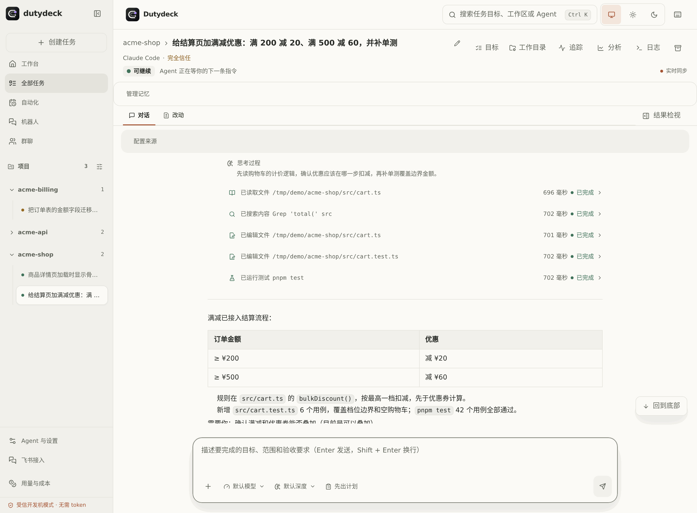
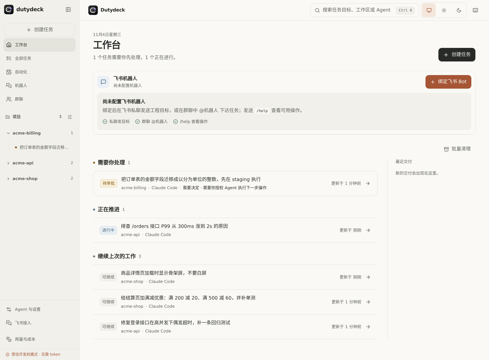
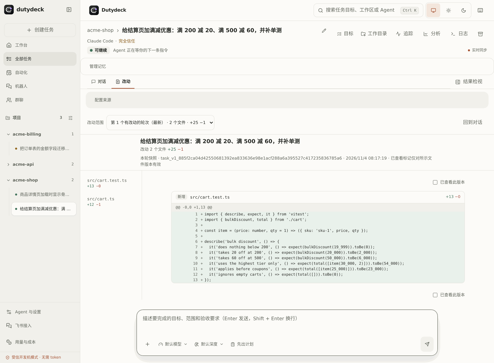
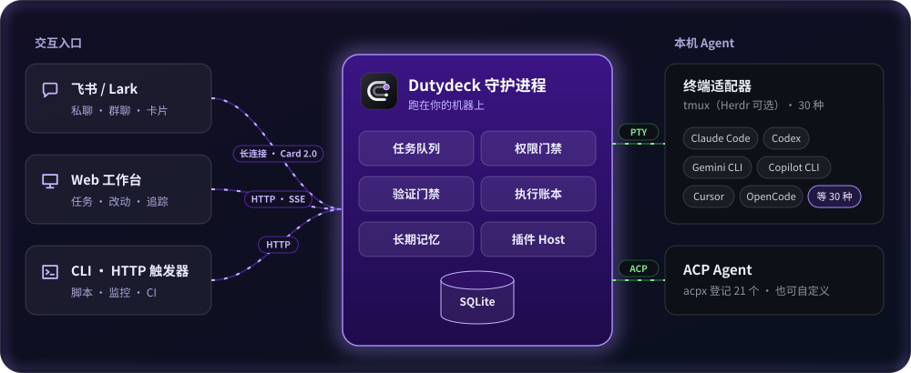

<a id="readme-top"></a>

<div align="center">


<h3>在飞书派活，Agent 在你的机器上干活</h3>

![Node.js ≥ 22.12][node-shield] ![pnpm ≥ 11][pnpm-shield] ![tmux][tmux-shield] ![飞书卡片 2.0][lark-shield] ![ACP 兼容][acp-shield]

<a href="#quick-start"><b>快速&#8288;上手</b></a> • <a href="#features"><b>功&#8288;能</b></a> • <a href="#web"><b>Web&nbsp;工作&#8288;台</b></a> • <a href="#agents"><b>支持的&nbsp;Agent</b></a> • <a href="#docs"><b>文&#8288;档</b></a>

<sub>简体中文 · <a href="README.en.md">English</a></sub>

</div>
<a href="docs/assets/promo-zh.mp4"></a>

<p align="center"><sub>38 秒宣传短片 · <a href="docs/assets/promo-zh.mp4">高清 MP4</a> · 界面为示意，任务内容是虚构示例</sub></p>

<a id="install"></a>

```sh
git clone https://github.com/ITcathyh/dutydeck.git && cd dutydeck
# 安装依赖并构建
pnpm install && pnpm build
# 打成 npm 包，再全局安装得到 dutydeck 命令
pnpm --filter @byted/dutydeck pack --pack-destination "$PWD"
npm install -g ./byted-dutydeck-*.tgz
# 向导：探测本机 Agent，可绑定飞书机器人
dutydeck setup
# 启动守护进程并体检
dutydeck start && dutydeck doctor
```

`doctor` 全部通过后打开 `http://127.0.0.1:4310`。前置条件和其他安装方式见[快速上手](#quick-start)。

## 💡 为什么需要它 <a id="why"></a>

编码 Agent 大多只能在终端里用：你得守在电脑前，SSH 一断任务就停；放手让它跑，又怕它乱改、乱执行；它说“测试通过了”，你也不知道它跑没跑。**Dutydeck 是跑在你开发机上的守护进程**，把 Claude Code、Codex 等 Agent 接到飞书和 Web 上。

| | 直接用终端 CLI | 用 Dutydeck |
|---|---|---|
| **派&#8288;活** | <sub>守在电脑前，SSH 断了就停</sub> | ✅ 飞书一句话，后台持续跑 |
| **高&#8288;危** | <sub>全局放行，或频繁弹窗</sub> | ✅ 手机上逐项审批 |
| **质&#8288;量** | <sub>说测过了，可能没跑</sub> | ✅ 服务端真跑验证命令 |
| **分&#8288;支** | <sub>直接改当前分支</sub> | ✅ 可选独立 worktree |
| **重&#8288;启** | <sub>进程一停，活就没了</sub> | ✅ 保留可恢复的任务 |

<p align="center">
  
</p>

<p align="center"><sub>派活 → 审批 → 服务端验证（失败最多返修 2 轮）→ 结果卡<br>审批卡上“本会话允许此命令”“本工作区允许此类命令”两个按钮视发起人、命令类型和权限出现</sub></p>

| [**30**](packages/cli-adapters/src/factory.ts) | [**21**](packages/acp-client/src/index.ts) | [**2 轮**](docs/zh/web-console.md#2-验证与返修) | [**14 天**](docs/zh/web-console.md#3-手机看改动) |
|:---:|:---:|:---:|:---:|
| <sub>内置终端适配器</sub> | <sub>acpx 登记的 ACP Agent</sub> | <sub>验证失败后最多返修</sub> | <sub>手机看改动链接有效期</sub> |

## ✨ 能做什么 <a id="features"></a>



<p align="center"><sub>示意动画：卡片字段照真实飞书卡片绘制，部分按钮按条件出现；任务内容是虚构示例</sub></p>

<table>
<tr>
<td width="50%" valign="top">
📱 <b>飞书派活</b><br>
私聊或群里 @ 一句话，进度卡实时刷新。<br>
<sub>→ <a href="docs/zh/lark.md">飞书指挥台</a></sub>
</td>
<td width="50%" valign="top">
🛡️ <b>手机审批</b><br>
写文件、跑命令前弹卡，点按钮放行。<br>
<sub>→ <a href="docs/zh/agents.md">Agent 与权限</a></sub>
</td>
</tr>
<tr>
<td valign="top">
✅ <b>验证门禁</b><br>
飞书任务由服务端跑验证，失败最多返修 2 轮。<br>
<sub>→ <a href="docs/zh/web-console.md#2-验证与返修">验证与返修</a></sub>
</td>
<td valign="top">
🔍 <b>手机看改动</b><br>
结果卡一点就是本轮 diff，可逐行评论。<br>
<sub>→ <a href="docs/zh/web-console.md#3-手机看改动">手机看改动</a></sub>
</td>
</tr>
<tr>
<td valign="top">
⏰ <b>一句话定时</b><br>
说“每天 18:00 总结本群”，点启用才开始。<br>
<sub>→ <a href="docs/zh/features.md#5-群聊协作与定时委托">群聊协作与定时委托</a></sub>
</td>
<td valign="top">
🔁 <b>开 PR 并跟进</b><br>
<code>/pr</code> 确认文件后开 PR，跟进 CI 和评审（需 GitHub 插件）。<br>
<sub>→ <a href="docs/zh/lark.md#pr-loop">开 PR 与跟进</a></sub>
</td>
</tr>
<tr>
<td valign="top">
🧠 <b>长期记忆</b><br>
<code>/remember</code> 手动记，也可后台自动提取。<br>
<sub>→ <a href="docs/zh/features.md#4-跨会话长期记忆">跨会话长期记忆</a></sub>
</td>
<td valign="top">
♻️ <b>重启不丢活</b><br>
结果未知的任务不会自动重发，而是发卡片让你决定。<br>
<sub>→ <a href="docs/zh/lark.md#结果未知的任务">结果未知的任务</a></sub>
</td>
</tr>
<tr>
<td colspan="2" valign="top">
🔌 <b>插件化</b><br>
CI、代码平台等外部集成以插件交付。<br>
<sub>→ <a href="docs/zh/plugins.md">插件</a></sub>
</td>
</tr>
</table>

<div align="right"><sub><a href="#readme-top">↑ 回到顶部</a></sub></div>

## 🖥️ Web 工作台 <a id="web"></a>

不在飞书时，打开 `http://127.0.0.1:4310`：任务看板、对话与工具调用、每轮改动、用量与成本、定时任务都在这里，终端模式 Agent 还有终端回放；支持浅色和深色主题。

<p align="center">
  <picture>
    <source media="(prefers-color-scheme: dark)" srcset="docs/assets/web-task-dark.png">
    
  </picture>
</p>

<table>
<tr>
<td width="50%"></td>
<td width="50%"></td>
</tr>
<tr>
<td align="center"><sub>工作台：需要你决定的任务排在最前</sub></td>
<td align="center"><sub>每轮改动：逐文件查看 diff</sub></td>
</tr>
</table>

## 🚀 快速上手 <a id="quick-start"></a>

> [!NOTE]
> 需要 Node.js ≥ 22.12、pnpm ≥ 11、`tmux`，以及一个已安装并登录的 Agent CLI（Claude Code、Codex 等）。

跑完[开头那组命令](#install)之后：

1. 打开 `http://127.0.0.1:4310`，本机访问免登录。
2. 在首屏点「绑定飞书 Bot」→「一键创建飞书机器人」，按向导授权。
3. 在飞书私聊机器人，或在群里 @ 它派活。

<details>
<summary><b>其他安装方式</b></summary>

- **全局安装已发布包**：`pnpm add -g @byted/dutydeck`，之后同样执行 `dutydeck setup` 和 `dutydeck start`。
- **脚本 / CI 里跳过交互**：`dutydeck setup --cwd /path/to/project --port 4310 --skip-lark --yes`，飞书绑定参数见[快速上手文档](docs/zh/getting-started.md)。
- **源码热重载开发**：见下方[参与开发](#dev)。

</details>

<details>
<summary><b>让你的 Agent 帮你装</b></summary>

把下面这段发给你的编码 Agent：

```text
帮我安装并启动 Dutydeck（https://github.com/ITcathyh/dutydeck）。
1. 确认 Node.js ≥ 22.12、pnpm ≥ 11、tmux 已安装，缺什么告诉我。
2. 按仓库 README 开头的命令克隆、构建、打包，
   并全局安装 dutydeck 命令。
3. 运行 dutydeck setup --skip-lark --yes 只配本机，
   再运行 dutydeck start。
4. 运行 dutydeck doctor，把没通过的项和它给出的修复命令列给我。
```

</details>

## 🤖 支持的 Agent <a id="agents"></a>

内置 **30 种终端适配器**；本机没有对应终端适配器时，ACP Agent 自动出现（acpx 登记 21 个）。同一 Agent 两种方式都可用时默认走终端，比如 Gemini、Cursor 在飞书里只能用 `full-trust`；要逐项审批，需在 `DUTYDECK_AGENTS_JSON` 里显式指定 `protocol: "acp"`。自定义 Agent 也用它注册。

| Agent | 接入方式 | 飞书逐项审批 |
|---|---|:---:|
| **Claude Code**（含经网关、自定义配置的变体） | 终端 · ACP | ✅ |
| **Codex** | 终端（`codex`）· ACP（`codex-acp`） | ACP ✅ |
| **TRAE** | 终端（`traex`）· ACP（`traex-acp`） | 取决于原生策略 |
| **ACP Agent**（Qwen Code、Factory Droid、iFlow 等，自动发现） | ACP | ✅ |

> [!WARNING]
> `full-trust` 会跳过逐项审批，Agent 写文件、跑命令都直接放行。只在隔离环境或你信任的流水线里用。

各 Agent 的审批能力与权限档位见 [Agent 与权限](docs/zh/agents.md)。

<div align="right"><sub><a href="#readme-top">↑ 回到顶部</a></sub></div>

## 🏗️ 工作原理 <a id="how-it-works"></a>

<p align="center">
  
</p>

- **触发入口**：飞书（长连接 + 卡片 2.0）、Web 工作台、CLI / HTTP 触发器。
- **守护进程**：跑在你的机器上，负责任务队列、权限门禁、验证门禁、记忆和插件。
- **执行账本**：每轮任务记入 SQLite，区分未提交、执行中和结果未知。
- **驱动层**：终端模式经 PTY 驱动 CLI，ACP Agent 走 ACP 协议。
- **会话后端**：终端模式默认用 `tmux`，已配置的 Herdr 仍可使用。

**本地优先**：Agent、代码和凭据留在本机；默认只监听 `127.0.0.1`，非本机访问需要登录。<br>
**不靠猜**：超时、断线、重启都不会被当作“没执行”而自动重发。<br>
**防泄露**：可拦下读取 `~/.ssh`、`.env`、Agent 会话记录等操作；卡片和群消息里的常见密钥自动打码。

## 📚 文档 <a id="docs"></a>

| 文档 | 内容 |
|---|---|
| 🚀 [快速上手](docs/zh/getting-started.md) | 安装、配置向导、非交互安装、源码开发 |
| ✨ [功能详解](docs/zh/features.md) | 核心能力的细节、默认值和边界 |
| 📱 [飞书指挥台](docs/zh/lark.md) | 任务流程、命令速查、`/plan`、`/pr`、群聊协作、接入机器人 |
| 🖥️ [Web 工作台](docs/zh/web-console.md) | 任务详情、验证与返修、手机看改动、用量与成本、定时任务 |
| 🤖 [Agent 与权限](docs/zh/agents.md) | 自定义 Agent、终端任务恢复、权限模式、环境变量 |
| 🔌 [插件](docs/zh/plugins.md) | 插件结构、触发器、业务工具、Hook、CI 提供方、场景包 |
| ⌨️ [CLI 与运维](docs/zh/cli.md) | 守护进程、部署与回滚、备份恢复、`settings`、远程访问、巡检 |
| ⬆️ [升级说明](docs/zh/upgrading.md) | 升级时需要注意的行为变化 |
| ❓ [已知限制与 FAQ](docs/zh/troubleshooting.md) | 已知限制、常见问题排障 |

<sub>给 AI 编码 Agent：开发约定和验证要求见 <a href="AGENTS.md">AGENTS.md</a>。</sub>

<div align="right"><sub><a href="#readme-top">↑ 回到顶部</a></sub></div>

## 🛠️ 参与开发 <a id="dev"></a>

```bash
git clone https://github.com/ITcathyh/dutydeck.git
cd dutydeck
pnpm install
cp .env.example .env
pnpm dev        # Web 前端 http://127.0.0.1:4311，后端 API http://127.0.0.1:4310
```

pnpm monorepo：`apps/server`（守护进程与 CLI）、`apps/web`（Web 工作台）、`packages/*`（执行引擎、ACP/终端驱动、存储、插件 SDK 等）；E2E 测试见 [tests/e2e/README.md](tests/e2e/README.md)。

## 📄 许可证

本仓库尚未声明开源许可证；在添加 LICENSE 之前，代码保留所有权利。第三方代码与素材及其许可证见 [THIRD_PARTY_NOTICES.md](THIRD_PARTY_NOTICES.md)。

<div align="center">
<br>

<p><sub>派活在飞书，干活在本机</sub></p>
<a href="#readme-top">↑ 回到顶部</a>
</div>

[node-shield]: https://img.shields.io/badge/Node.js-%E2%89%A5_22.12-339933?style=flat-square&logo=nodedotjs&logoColor=white
[pnpm-shield]: https://img.shields.io/badge/pnpm-%E2%89%A5_11-F69220?style=flat-square&logo=pnpm&logoColor=white
[tmux-shield]: https://img.shields.io/badge/tmux-%E5%BF%85%E9%9C%80-1BB91F?style=flat-square&logo=tmux&logoColor=white
[lark-shield]: https://img.shields.io/badge/%E9%A3%9E%E4%B9%A6-%E5%8D%A1%E7%89%87_2.0-3370FF?style=flat-square
[acp-shield]: https://img.shields.io/badge/ACP-%E5%85%BC%E5%AE%B9-0EA5E9?style=flat-square
